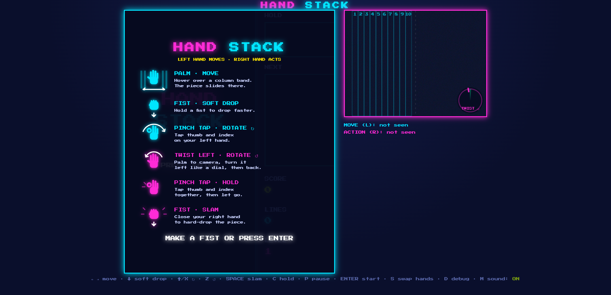
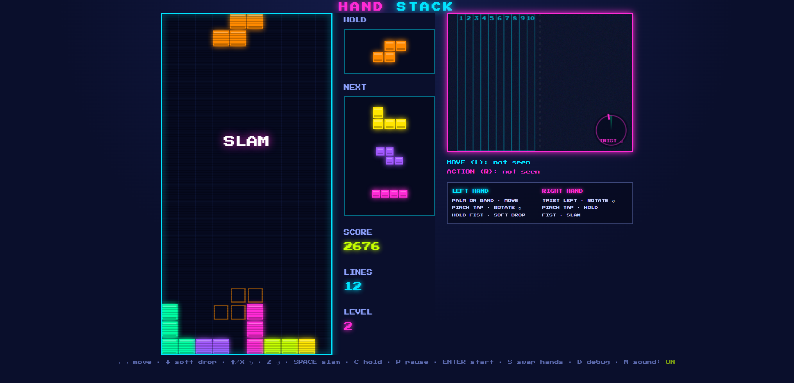
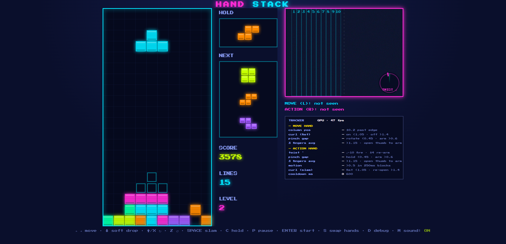
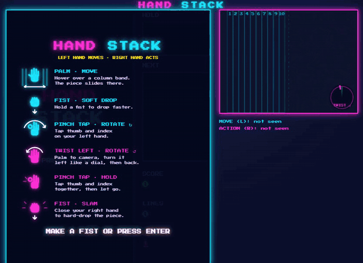
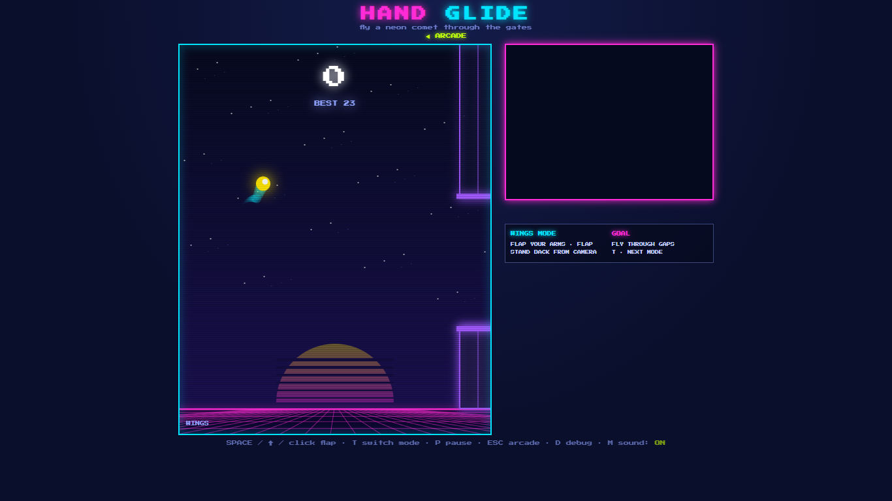
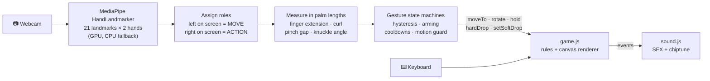

<div align="center">

# ✋ HAND STACK ✋

**A neon falling-block puzzle you play with your bare hands.**

*An arcade idea from the 1980s, rebuilt for 2026 with real-time hand tracking in the browser.*


**Retro Remix track · KCL Tech First Year Hack · built with JetBrains Air**

🕹️ **Now part of HAND ARCADE:** open the site and you walk into a neon arcade with two cabinets, **Hand Stack** and **[Hand Glide](#-bonus-game-hand-glide)**. Point at a cabinet and hold a fist to play (or click, or use ←/→ and Enter). Esc in either game takes you back to the arcade.


*Real hand-tracking gameplay: the left hand (cyan) picks the column, the right hand (pink) rotates, holds and slams.*

[▶ Watch the full hand-tracking clip (40 s)](docs/media/human_game.mp4) · [Quick start](#-quick-start) · [Controls](#-controls) · [Bonus: Hand Glide](#-bonus-game-hand-glide) · [How it works](#-how-it-works)

</div>

---

## 🕹️ What is it?

Hand Stack is a falling-block puzzle in its own neon arcade style, but there's **no controller**. Your webcam watches both hands:

- your **left hand** steers the falling piece across the board and drops it faster
- your **right hand** rotates it, slams it down and puts it on hold

Hand tracking runs **entirely in the browser** with Google's MediaPipe. Nothing gets installed, and no video ever leaves your machine. If there's no camera, the whole game still plays on the keyboard.

### Features

- 🖐️ **Two-handed gesture control:** six gestures across two hands, with live skeleton overlays (cyan = move hand, pink = action hand)
- 🎯 **Column bands:** ten numbered bands on the camera view map your palm straight onto the board, with hysteresis so the piece doesn't jitter between columns
- 🔁 **Self-calibrating wrist twist:** whatever angle you hold your hand at becomes "neutral", with a live dial gauge
- 👌 **Robust pinch detection** that can't be confused with a fist
- 🧩 **Proper puzzle rules:** 7-bag randomiser, wall kicks in both directions, ghost piece, hold, 3-piece preview, levels and speed-up
- 🎵 **Synthesised audio:** an original chiptune loop that speeds up each level, plus sound effects, all generated with the Web Audio API (no audio files)
- 🛠️ **Live debug panel (D):** every gesture value next to its threshold, plus the tracker's frame rate
- ♿ **Left-handed mode (S)** and a **full keyboard fallback**
- 💻 Fits a 1366×768 laptop screen

---

## 📸 Screenshots

| Start screen and gesture guide | Mid-game |
|---|---|
|  |  |

| Debug panel (press D) |
|---|
|  |

| Keyboard demo (scripted, 11 s) |
|---|
|  |

> **About these captures:** the screenshots above, the keyboard demo and its [full 42 s clip](docs/media/gameplay.mp4) were recorded in headless Chrome. The game was driven by scripted **keyboard** input, and the camera was a blank synthetic feed. That's why their camera panels show no hands. The GIF at the top and the [hand-tracking clip](docs/media/human_game.mp4) are real webcam play.

---

## 🚀 Quick start

You need [Node.js](https://nodejs.org/) 20+, a webcam and an internet connection. The hand-tracking model loads from a CDN.

```bash
git clone https://github.com/Neev-Dhall/KCL-Hack.git
cd KCL-Hack
npm install
npm run dev
```

Open the URL Vite prints (usually **http://localhost:5173**) in **Google Chrome** and allow camera access. That's the arcade lobby: hold a fist over the Hand Stack cabinet (or click it). Hand Stack itself is at `/stack.html` and Hand Glide at `/glide.html`. In Hand Stack, **make a fist with your right hand** or press **Enter** to start.

> 🔊 Sound and music start after your first click or key press, because browsers block audio until then.
> 📷 If the camera is blocked, the game says so and carries on with the keyboard.

---

## 🎮 Controls

Left hand = **MOVE** hand (cyan). Right hand = **ACTION** hand (pink). Press **S** to swap them for left-handers.

### Hands

| Hand | Gesture | Action |
|---|---|---|
| ✋ Left | Hold your palm over one of the 10 column bands on the camera view | Piece slides to that column |
| ✊ Left | Hold a closed fist | Soft drop |
| 👌 Left | Tap thumb and index together | Rotate 90° **clockwise** |
| 🔄 Right | Palm toward the camera, turn it **left** like a dial, then back to centre | Rotate 90° **anticlockwise** |
| 👌 Right | Tap thumb and index together | **Hold** the piece |
| ✊ Right | Close into a fist | **Slam** (hard drop); also starts the game |

### Keyboard

| Key | Action | Key | Action |
|---|---|---|---|
| ← → | Move | P | Pause |
| ↓ | Soft drop | Enter | Start / restart |
| ↑ or X | Rotate clockwise | S | Swap hand roles |
| Z | Rotate anticlockwise | D | Debug panel |
| Space | Hard drop | M | Mute (effects and music) |
| C | Hold | | |

### Scoring

| Clear | Points |
|---|---|
| 1 line (SINGLE) | 100 × level |
| 2 lines (DOUBLE) | 300 × level |
| 3 lines (TRIPLE) | 500 × level |
| 4 lines (QUAD!) | 800 × level |
| Soft drop / hard drop | +1 / +2 per row |

You go up a level every 10 lines. Gravity starts at 800 ms per row and gets 70 ms faster each level, down to a minimum of 80 ms.

---

## 🌠 Bonus game: Hand Glide

A second arcade game using the same hand tracking. Steer a glowing comet through gaps in neon laser gates over a synthwave grid. It has three control modes (**T** cycles):

- **WINGS mode (default): flap your arms like wings.** Stand back so your shoulders and hands are in view. Each downstroke flaps the comet, and raising your arms gets the next flap ready. This mode uses MediaPipe's **body pose** tracker (shoulders, elbows, wrists), which copes with fast arm movement much better than hand tracking.
- **SQUEEZE mode:** squeeze either hand to flap. Quick half-squeezes count.
- **STEER mode:** the comet follows your palm's height. Raise your hand to climb and lower it to dive. If your hand leaves the camera, gravity takes over.

| Start | In flight |
|---|---|
|  |  |

- Open it from the **PLAY HAND GLIDE ▶** link under the Hand Stack title, or go to `/glide.html`.
- Keyboard and mouse work too: **Space**, **↑** or **click** to flap, **T** to switch mode, **P** to pause, **D** for the debug panel, **M** to mute.
- The gaps get narrower and the scroll speed rises as your score climbs. From 10 gates, some gates **slide up and down**. Every 10 gates plays a jingle and speeds up the music.
- Crashes shake the screen and burst into sparks. Each mode keeps its own best score in your browser.

---

## 🧠 How it works



The code is split so each file has one job, and the hand code can only reach the game through its public API:

| File | Job |
|---|---|
| [`src/game.js`](src/game.js) | Game rules and drawing only: board, 7-bag randomiser, wall kicks, scoring, levels, the neon canvas renderer and CRT scanlines. It knows nothing about cameras. |
| [`src/hands.js`](src/hands.js) | Camera, MediaPipe hand tracking and gesture detection. It only calls the API that `game.js` exports. **Every gesture threshold is in one commented block at the top of the file.** |
| [`src/sound.js`](src/sound.js) | Sound effects and an original 4-bar chiptune loop (Am–F–C–G), played by a small step sequencer on the Web Audio clock. |
| [`src/main.js`](src/main.js) | Wires it all together: keyboard, sound, music, screens and the game loop. |
| [`src/glide.js`](src/glide.js) + [`glide.html`](glide.html) | Hand Glide: physics, gates, drawing and fist-to-flap, with all tuning numbers at the top. |
| [`src/vision.js`](src/vision.js) + [`src/vision.worker.js`](src/vision.worker.js) | Runs MediaPipe in a **Web Worker** (a background thread) for both games. Camera frames are sent over as ImageBitmaps, and frames that arrive while the worker is busy are skipped, so tracking never freezes the game or builds up lag. |
| [`src/tracker.js`](src/tracker.js) | Shared webcam + MediaPipe setup for Hand Glide: hand tracking, plus body-pose tracking for wing flapping (loaded on demand). |
| [`vite.config.js`](vite.config.js) | Builds both pages. |

### Gesture tricks

- **Scale-free:** every distance is measured in *palm lengths* (wrist to the middle-finger knuckle). Gestures work the same close to the camera or far away.
- **Hysteresis everywhere:** columns, fists and pinches each have separate "on" and "off" thresholds, so nothing flickers at the edge.
- **Self-calibrating twist:** the angle you first raise your hand at becomes neutral, and neutral slowly follows your hand while it rests. A 10° turn left rotates once. You come back to centre to re-arm, and turning right never triggers anything, so wobbling back can't double-rotate.
- **Pinch vs fist:** a pinch is an "OK sign": thumb and index touching while the other three fingers stay straight. It has to *start* from an open thumb and hold for 2 frames. A fist curls those fingers, so closing or opening a fist can never count as a pinch.
- **Never blocks the game:** hand and pose tracking run in a background Web Worker. Both games hold a steady 60 fps while tracking runs at the camera's ~30 fps.
- **Motion guard:** after a slam or hold, the action hand is ignored for 600 ms. Twists don't count while the hand is moving fast or mid-pinch.

### Tuning

All thresholds live at the top of [`src/hands.js`](src/hands.js). Press **D** in game to see each live value next to its threshold, so you can tune a gesture by watching the numbers.

| Gesture | Key values |
|---|---|
| Column bands | 5–47% of frame width · switch 0.2 of a band past the edge |
| Fist (soft drop / slam) | curl < 1.05 on · > 1.4 off / re-arm |
| Pinch | gap < 0.45 · arm > 0.6 · other fingers avg > 1.15 · 2 frames |
| Twist | 10° left fires · ±4° re-arms · EMA α 0.5 · `TWIST_SIGN` flips direction |
| Motion guard | > 0.5 palm lengths in 250 ms · 600 ms cooldown |

---

## 🧰 Tech

- **Plain JavaScript, HTML canvas and CSS**, served with **Vite**. No frameworks.
- **[MediaPipe Tasks Vision](https://ai.google.dev/edge/mediapipe/solutions/vision/hand_landmarker)** `HandLandmarker` (`float16` model, `VIDEO` mode, 2 hands), loaded from jsDelivr.
- **Web Audio API** for every sound and the music.
- **[Press Start 2P](https://fonts.google.com/specimen/Press+Start+2P)** from Google Fonts.

## 🙌 Credits

Built for the **Retro Remix** track at **KCL Tech First Year Hack**, with **JetBrains Air**.
The visual style, palette, sounds and music are original to this project.
