<div align="center">

# 🕹️ HAND ARCADE 🕹️

**A neon arcade where your hands are the controller.**

*Three retro games, one webcam, no controllers. Hand tracking runs live in the browser.*


**Retro Remix track · KCL Tech First Year Hack · built with JetBrains Air**

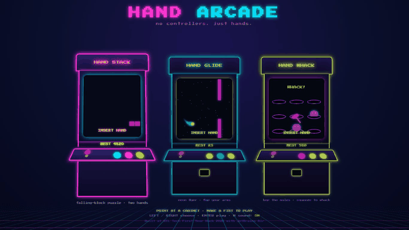

**[▶ Play it now: neev-dhall.github.io/KCL-Hack](https://neev-dhall.github.io/KCL-Hack/)** (Chrome, allow the camera)

[Quick start](#-quick-start) · [The arcade](#-the-arcade) · [🧱 Hand Stack](#-hand-stack) · [🌠 Hand Glide](#-hand-glide) · [🔨 Hand Whack](#-hand-whack) · [How it works](#-how-it-works)

</div>

---

## ✋ What is it?

Hand Arcade is a virtual arcade room with three cabinets. Each one is a complete game, and each is played with your body in front of a webcam rather than a keyboard or controller:

| | Game | Genre | You play it by… |
|---|---|---|---|
| 🧱 | **[Hand Stack](#-hand-stack)** | Falling-block puzzle | steering with your left hand, rotating, holding and slamming with your right |
| 🌠 | **[Hand Glide](#-hand-glide)** | Neon flyer | flapping your arms like wings (or squeezing / steering with a hand) |
| 🔨 | **[Hand Whack](#-hand-whack)** | Whack-a-mole | aiming with your palms and squeezing to bring the hammer down |

Everything runs **in the browser**. Nothing is installed, and no video ever leaves your machine. Every game also works with the keyboard and mouse if there's no camera.

### Shared features

- 🖐️ **Live skeleton overlays** on the camera view, so you can always see what the tracker sees
- 🏠 **Hands-free navigation:** choose a game in the lobby with a fist, and use big hover buttons (**◀ ARCADE** / **PLAY ▶**) on every start, pause and game-over screen
- 🎵 **Synthesised audio:** an original chiptune loop plus sound effects, generated with the Web Audio API (no audio files)
- 🏆 **Best scores** saved in your browser and shown on each cabinet
- 🛠️ **Debug panel (D)** in every game: each live gesture value next to its threshold
- ⚡ **60 fps:** hand and pose tracking run in a background Web Worker, so the games never stutter
- 💻 Fits a 1366×768 laptop screen

---

## 🚀 Quick start

You need [Node.js](https://nodejs.org/) 20+, a webcam and an internet connection (the tracking models load from a CDN).

```bash
git clone https://github.com/Neev-Dhall/KCL-Hack.git
cd KCL-Hack
npm install
npm run dev
```

Open the URL Vite prints (usually **http://localhost:5173**) in **Google Chrome** and allow camera access. You'll land in the arcade.

To build a static site: `npm run build` writes everything to `dist/`, which works from any folder (for example GitHub Pages).

> 📷 If the camera is blocked, each page says so and carries on with keyboard and mouse.

---

## 🏠 The arcade

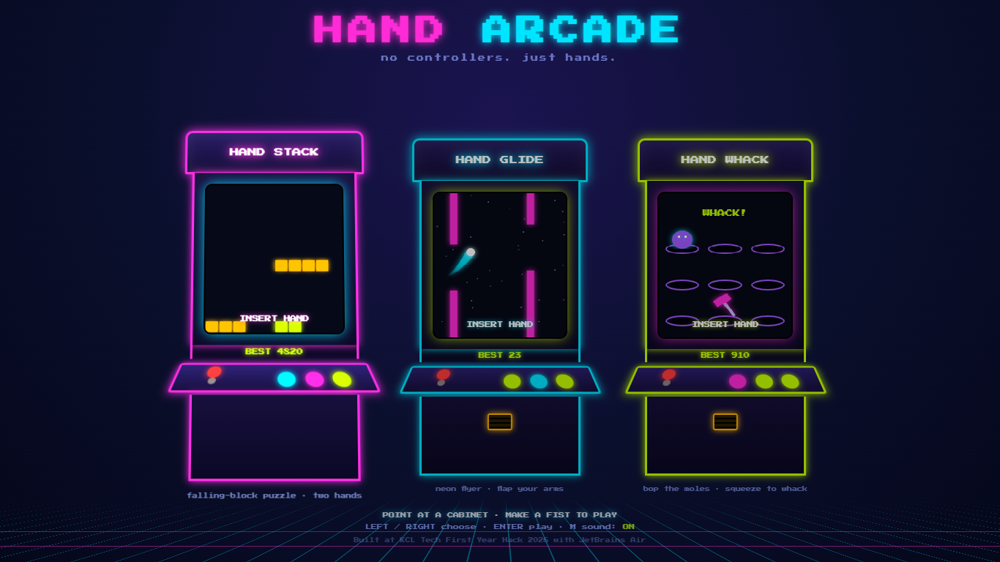

The lobby is a dark arcade room with a flickering marquee and three cabinets. Each cabinet screen loops a little attract-mode demo of its game and shows your best score.

| To… | Hands | Keyboard / mouse |
|---|---|---|
| Choose a cabinet | Move your palm; a glowing cursor follows it | ← / → or hover |
| Play it | Make a fist and hold it until the ring fills (0.6 s) | Enter or click |
| Leave a game | Hover a hand over **◀ ARCADE** for 1 s on a menu screen | Esc |
| Start / retry / resume | Hover a hand over **PLAY ▶** for 1 s | Each game's start key |

Choosing a cabinet zooms the room into its screen and fades into the game.

---

## 🧱 Hand Stack

**A falling-block puzzle you play with both hands.** Your **left hand** (cyan) steers the falling piece across the board and drops it faster. Your **right hand** (pink) rotates it, slams it down and puts it on hold.

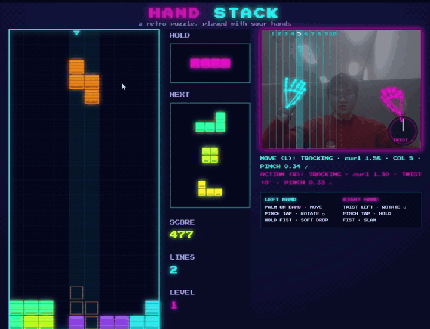

**[▶ Watch the full hand-tracking clip (40 s)](docs/media/human_game.mp4)**

| Start screen and gesture guide | Mid-game |
|---|---|
| 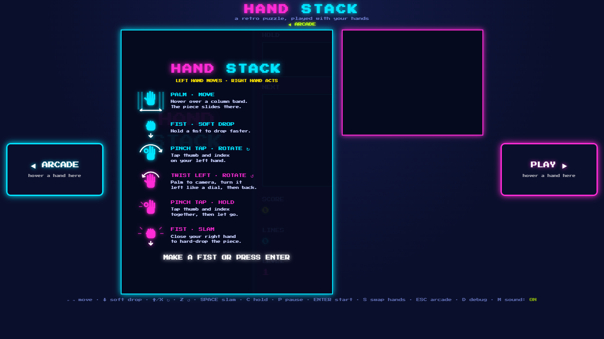 | 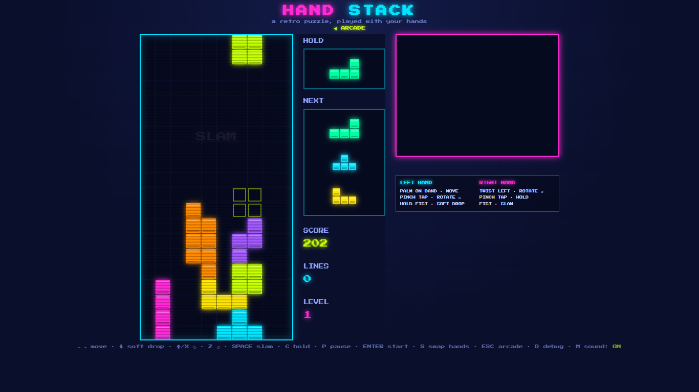 |

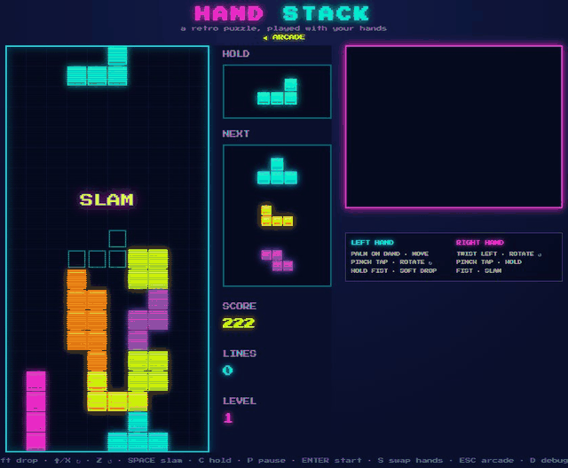

### Features

- 🎯 **Column bands:** ten numbered bands on the camera view map your palm straight onto the board, with hysteresis so the piece doesn't jitter between columns
- 🔁 **Self-calibrating wrist twist:** whatever angle you hold your hand at becomes "neutral", with a live dial gauge
- 👌 **Robust pinch detection** that can't be confused with a fist
- 🧩 **Proper puzzle rules:** 7-bag randomiser, wall kicks in both directions, ghost piece, hold, 3-piece preview, levels and speed-up
- 🎵 The chiptune speeds up every level
- ♿ **Left-handed mode (S)** swaps the hand roles

### Controls

| Hand | Gesture | Action |
|---|---|---|
| ✋ Left | Hold your palm over one of the 10 column bands on the camera view | Piece slides to that column |
| ✊ Left | Hold a closed fist | Soft drop |
| 👌 Left | Tap thumb and index together | Rotate 90° **clockwise** |
| 🔄 Right | Palm toward the camera, turn it **left** like a dial, then back to centre | Rotate 90° **anticlockwise** |
| 👌 Right | Tap thumb and index together | **Hold** the piece |
| ✊ Right | Close into a fist | **Slam** (hard drop); also starts the game |

| Key | Action | Key | Action |
|---|---|---|---|
| ← → | Move | P | Pause |
| ↓ | Soft drop | Enter | Start / restart |
| ↑ or X | Rotate clockwise | S | Swap hand roles |
| Z | Rotate anticlockwise | D | Debug panel |
| Space | Hard drop | M | Mute |
| C | Hold | Esc | Back to the arcade |

### Scoring

| Clear | Points |
|---|---|
| 1 line (SINGLE) | 100 × level |
| 2 lines (DOUBLE) | 300 × level |
| 3 lines (TRIPLE) | 500 × level |
| 4 lines (QUAD!) | 800 × level |
| Soft drop / hard drop | +1 / +2 per row |

You go up a level every 10 lines. Gravity starts at 800 ms per row and gets 70 ms faster each level, down to a minimum of 80 ms.

<details>
<summary>🛠️ Debug panel (press D)</summary>


</details>

---

## 🌠 Hand Glide

**Fly a glowing comet through neon laser gates over a synthwave grid.** By default you play it with your whole body: stand back and **flap your arms like wings**.

**[▶ Watch the Hand Glide demo](docs/media/glide_demo.mp4)**: real webcam play, flying the comet through the gates.

| Start | In flight |
|---|---|
| 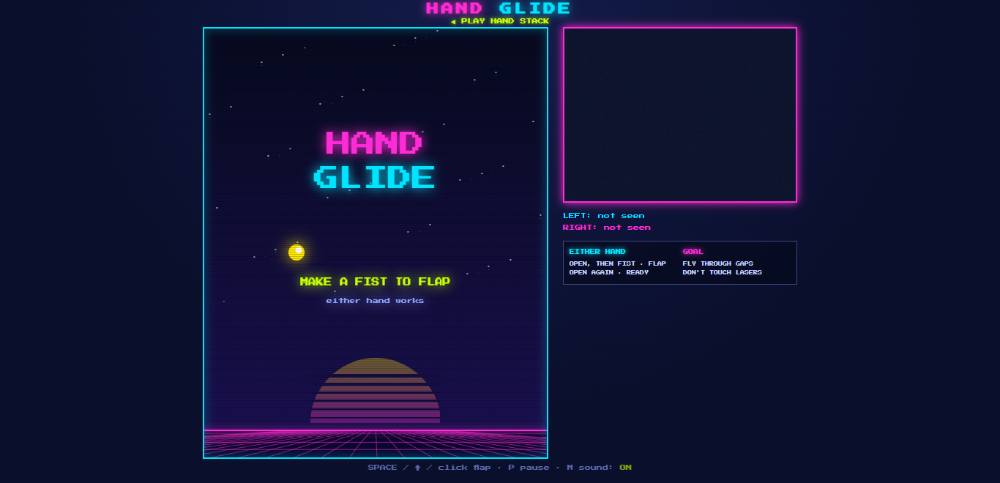 |  |

### Three control modes (T cycles)

- **WINGS (default): flap your arms.** Keep your shoulders and hands in view. Each downstroke flaps the comet, and raising your arms readies the next flap. This mode uses MediaPipe's **body pose** tracker (shoulders, elbows, wrists), which copes with fast arm movement much better than hand tracking.
- **SQUEEZE:** squeeze either hand to flap. Quick half-squeezes count.
- **STEER:** the comet follows your palm's height. Raise your hand to climb and lower it to dive. If your hand leaves the camera, gravity takes over.

### How it plays

- The gaps get narrower and the scroll speed rises as your score climbs. From 10 gates, some gates **slide up and down**.
- Every 10 gates plays a jingle and speeds up the music.
- Crashes shake the screen and burst into sparks. Each mode keeps its own best score.
- Keyboard and mouse: **Space**, **↑** or **click** to flap, **T** to switch mode, **P** to pause, **D** debug, **M** mute, **Esc** back to the arcade.

---

## 🔨 Hand Whack

**Bop the neon moles before they duck back down.** Each of your hands is a hammer: move your palm to aim at one of nine holes, then **squeeze your hand** to whack. Two hands means two hammers.

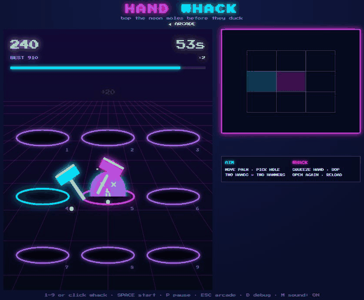

| Start | Mid-game | Time's up |
|---|---|---|
| 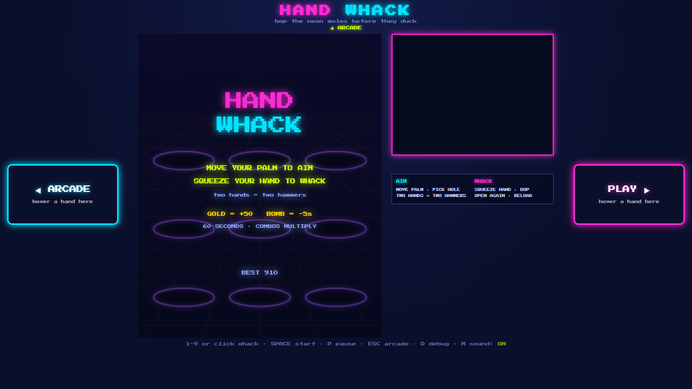 | 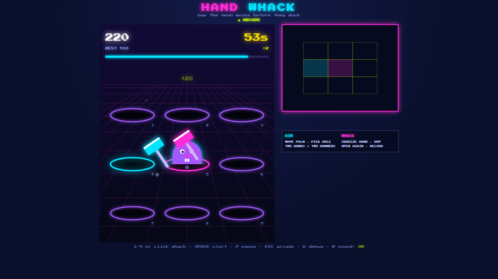 | 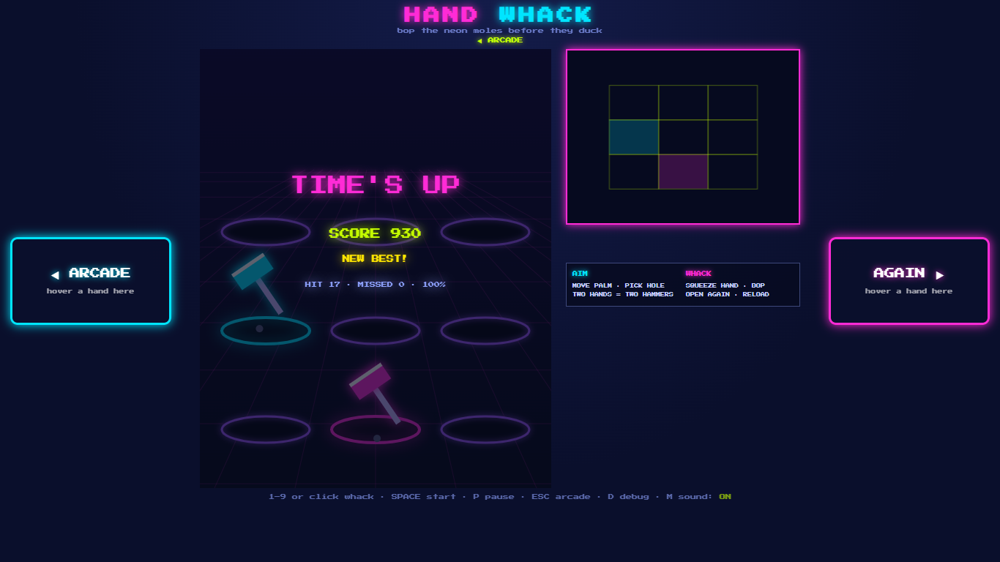 |

### How it plays

- **60-second rounds.** Moles pop up faster, stay up for less time and appear in greater numbers as the clock runs down.
- 👑 **Golden moles** are quick and worth **+50**.
- 💣 **Bombs** appear after 10 seconds. Whack one and you lose **5 seconds**.
- 🔥 **Combos:** every 5 hits in a row raises your multiplier, up to **×5**. A miss, a whiff or a mole that escapes resets it.
- The camera view shows a 3×3 aiming grid, so you can see which hole each hand is pointing at. The aimed hole glows in that hammer's colour.

### Controls

| Hand | Gesture | Action |
|---|---|---|
| ✋ Either | Move your palm | Aim the hammer at a hole |
| ✊ Either | Squeeze (a quick fist), then open again | Whack; also starts the game |

| Key | Action | Key | Action |
|---|---|---|---|
| 1–9 | Whack a hole (top row = 1 2 3) | P | Pause |
| Numpad | Whack a hole (numpad layout) | D | Debug panel |
| Click | Whack the nearest hole | M | Mute |
| Space / Enter | Start / retry | Esc | Back to the arcade |

---

## 🧠 How it works

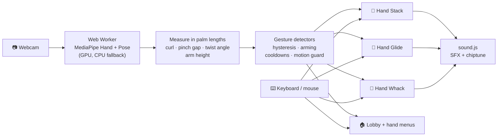

Each page is its own Vite entry, and the games share the tracking, sound and menu code:

| File | Job |
|---|---|
| [`index.html`](index.html) + [`src/arcade.js`](src/arcade.js) + [`src/arcade.css`](src/arcade.css) | The lobby: CSS cabinets, attract-mode demos, hand cursor and fist-to-select, zoom transition. |
| [`stack.html`](stack.html) + [`src/main.js`](src/main.js) | Hand Stack page: keyboard, sound, music, screens and the game loop. |
| [`src/game.js`](src/game.js) | Hand Stack rules and drawing only: board, 7-bag randomiser, wall kicks, scoring, levels and the neon renderer. It knows nothing about cameras. |
| [`src/hands.js`](src/hands.js) | Hand Stack's gesture detection. It only calls the API that `game.js` exports. **Every gesture threshold is in one commented block at the top.** |
| [`glide.html`](glide.html) + [`src/glide.js`](src/glide.js) | Hand Glide: physics, gates, drawing and the three control modes, with all tuning numbers at the top. |
| [`whack.html`](whack.html) + [`src/whack.js`](src/whack.js) | Hand Whack: moles, hammers, combos and the squeeze detector, with all tuning numbers at the top. |
| [`src/handmenu.js`](src/handmenu.js) | The hover-to-select **◀ ARCADE / PLAY ▶** buttons used on every game's menu screens. |
| [`src/tracker.js`](src/tracker.js) | Shared webcam + MediaPipe setup: hand tracking, plus body-pose tracking loaded on demand. |
| [`src/vision.js`](src/vision.js) + [`src/vision.worker.js`](src/vision.worker.js) | Runs MediaPipe in a **Web Worker**. Camera frames are handed over without copying, and frames that arrive while the worker is busy are skipped, so tracking never freezes a game or builds up lag. |
| [`src/sound.js`](src/sound.js) | Sound effects and an original 4-bar chiptune loop (Am–F–C–G), played by a small step sequencer on the Web Audio clock. |
| [`vite.config.js`](vite.config.js) | Builds all four pages. |

### Gesture tricks

- **Scale-free:** every distance is measured in *palm lengths* (wrist to the middle-finger knuckle), so gestures work the same close to the camera or far away.
- **Hysteresis everywhere:** columns, fists and pinches each have separate "on" and "off" thresholds, so nothing flickers at the edge.
- **Squeeze = a drop, not a threshold:** Hand Glide and Hand Whack detect a squeeze as your finger curl *dropping* from its recent high, so quick half-squeezes count, and the hand must open again before the next one.
- **Aim lock:** closing your hand shifts your palm slightly, so the lobby cursor and Whack's hammer hold their target while the fist is forming.
- **Self-calibrating twist:** in Hand Stack, the angle you first raise your hand at becomes neutral, and neutral slowly follows your hand while it rests.
- **Pinch vs fist:** a pinch is an "OK sign" that has to *start* from an open thumb and hold for 2 frames, so closing or opening a fist never counts as a pinch.
- **Menus can't misfire:** a hover button won't fire if a hand was already resting on it when the menu appeared. You have to move off and come back.

### Tuning

Every threshold lives in a commented block at the top of its file. Press **D** in any game to watch each live value next to its threshold.

| Gesture | Key values |
|---|---|
| Stack column bands | 5–47% of frame width · switch 0.2 of a band past the edge |
| Stack fist (soft drop / slam) | curl < 1.05 on · > 1.4 off / re-arm |
| Stack pinch | gap < 0.45 · arm > 0.6 · other fingers avg > 1.15 · 2 frames |
| Stack twist | 10° left fires · ±4° re-arms · EMA α 0.5 |
| Glide wings | arms drop 0.6 shoulder-widths → flap · rise 0.3 → ready |
| Glide / Whack squeeze | curl drops 0.35 → fire · rises 0.2 → ready |
| Whack aiming box | 18–82% of frame width · 20–80% of height |
| Lobby fist | curl < 1.15 held 0.6 s · open > 1.35 first |
| Hand menu | 1 s hover |

---

## 🧰 Tech

- **Plain JavaScript, HTML canvas and CSS**, served with **Vite**. No frameworks.
- **[MediaPipe Tasks Vision](https://ai.google.dev/edge/mediapipe/solutions/vision/hand_landmarker)**: `HandLandmarker` (2 hands) and `PoseLandmarker` (lite), in `VIDEO` mode inside a Web Worker, loaded from jsDelivr.
- **Web Audio API** for every sound and the music.
- **[Press Start 2P](https://fonts.google.com/specimen/Press+Start+2P)** from Google Fonts.

## 🙌 Credits

Built for the **Retro Remix** track at **KCL Tech First Year Hack**, with **JetBrains Air**.
The visual style, palette, sounds and music are original to this project.
